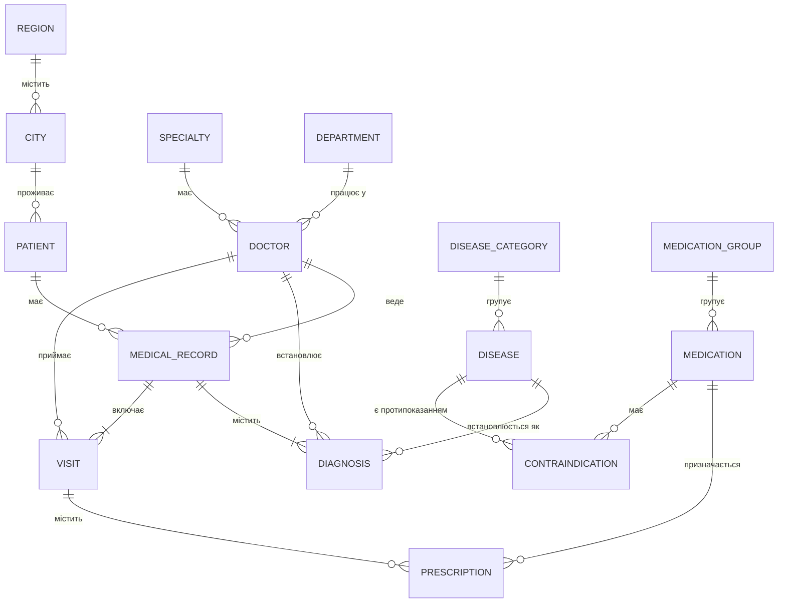
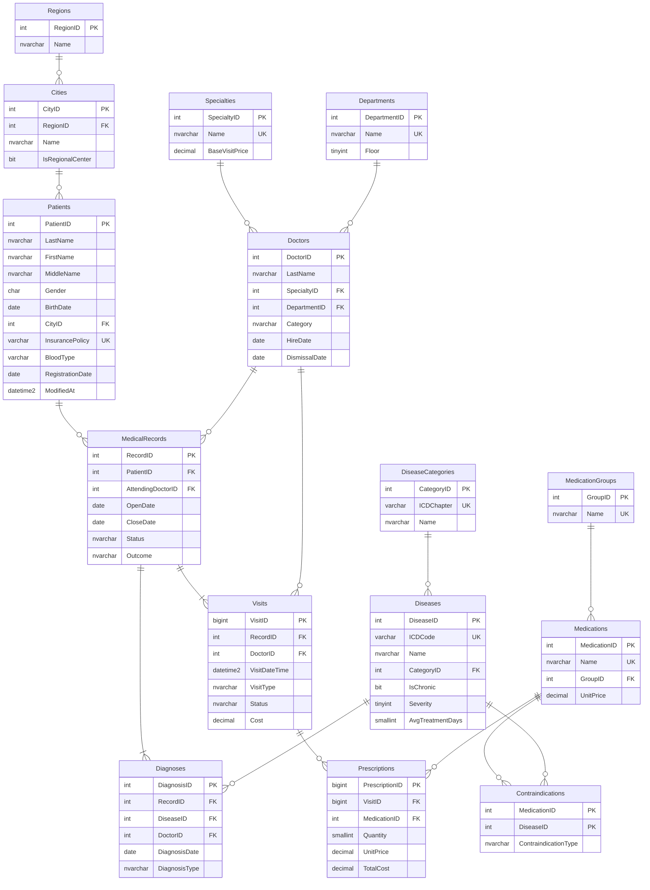

# Етап 1. Проектування бази даних «Поліклініка» (варіант 6)

## 1.1 Аналіз предметної області

### Опис
Поліклініка надає амбулаторну медичну допомогу населенню. Пацієнт звертається до лікаря
з певною хворобою — відкривається **історія хвороби** (випадок захворювання). У межах однієї
історії хвороби пацієнт відвідує одного або кількох лікарів (**візити**), лікарі встановлюють
**діагнози** (основний, супутні, ускладнення) з довідника **хвороб** (МКХ-10) та
**призначають ліки**. Деякі ліки мають **протипоказання** при певних хворобах — такі
призначення система має блокувати. Після завершення лікування історія хвороби
закривається з певним **результатом** (одужання, покращення, хронізація тощо).

### Основні сутності

| Сутність | Таблиця | Опис |
|---|---|---|
| Пацієнти | `Patients` | Особи, що обслуговуються поліклінікою |
| Лікарі | `Doctors` | Медичний персонал |
| Спеціальності | `Specialties` | Терапевт, кардіолог, невролог... |
| Відділення | `Departments` | Структурні підрозділи поліклініки |
| Хвороби | `Diseases` | Довідник хвороб за МКХ-10 |
| Класи хвороб | `DiseaseCategories` | Розділи МКХ-10 (J00-J99 — хвороби органів дихання...) |
| Історії хвороб | `MedicalRecords` | Випадок захворювання пацієнта від відкриття до закриття |
| Діагнози | `Diagnoses` | Хвороби, встановлені пацієнту в межах історії хвороби |
| Візити | `Visits` | Прийоми пацієнта у лікаря |
| Лікарства | `Medications` | Довідник лікарських засобів |
| Фармакологічні групи | `MedicationGroups` | Антибіотики, НПЗП, антигіпертензивні... |
| Призначення | `Prescriptions` | Ліки, призначені на візиті |
| Протипоказання | `Contraindications` | Зв'язок «ліки — хвороба», при якій їх не можна застосовувати |
| Регіони, Міста | `Regions`, `Cities` | Адреса проживання пацієнта |
| Журнал аудиту | `AuditLog` | Історія змін даних пацієнтів і лікарів |

### Бізнес-правила
1. Пацієнт може мати багато історій хвороб; кожна історія належить одному пацієнту і має
   одного лікуючого лікаря.
2. Історія хвороби має рівно один **основний** діагноз і довільну кількість супутніх діагнозів
   та ускладнень; одна хвороба не повторюється в межах однієї історії.
3. Візит відбувається лише в межах періоду історії хвороби (між датами відкриття і закриття)
   і лише до лікаря, який працював у поліклініці на дату візиту.
4. Вартість візиту = базова ціна спеціальності × коефіцієнт категорії лікаря
   (вища 1.30, перша 1.15, друга 1.05, без категорії 1.00). Скасований візит або неявка — 0 грн.
5. Ліки з **абсолютним** протипоказанням до будь-якої хвороби пацієнта (у поточній історії,
   активній на дату візиту, або хронічної) призначати заборонено. **Відносне** протипоказання
   дозволяє призначення, але генерує попередження.
6. Закрита історія хвороби обов'язково має дату закриття та результат; дата закриття не може
   бути раніше дати відкриття та останнього візиту.
7. Ціна ліків фіксується в призначенні на момент призначення (історична ціна).
8. Зміни даних пацієнтів і лікарів журналюються (для аудиту та SCD Type 2 у сховищі даних).

### Обсяги даних (вимоги варіанту)

| Таблиця | Мінімум за завданням | План |
|---|---|---|
| Patients | 50 000 | 55 000 |
| MedicalRecords (історії хвороб) | 500 000 | ~550 000 |
| Diagnoses | — | ~700 000 |
| Visits | — | ~1 300 000 |
| Prescriptions | — | ~1 000 000 |
| Період історії | 10 років | 2016-01-01 — 2025-12-31 |

### Обов'язкові звіти та їх джерела
1. **Список лікарів та їх пацієнтів** — Doctors, MedicalRecords, Patients, Visits.
2. **Історія хвороби пацієнта** — MedicalRecords, Diagnoses, Visits, Prescriptions.
3. **Завантаженість лікарів по місяцях** — Visits × календар.
4. **Аналіз ефективності лікування** — результати (Outcome) і тривалість лікування
   у порівнянні з нормативною (`Diseases.AvgTreatmentDays`).
5. **Статистика захворювань** — Diagnoses × Diseases × вік/стать/місто пацієнта × час.

## 1.2 Концептуальне проектування (ER-діаграма, нотація Crow's Foot)

**Типи зв'язків:**
- 1:N — Пацієнт → Історії хвороб, Лікар → Візити, Візит → Призначення тощо.
- M:N — Лікарства ↔ Хвороби (протипоказання), реалізовано асоціативною таблицею
  `Contraindications`; Історії хвороб ↔ Хвороби, реалізовано таблицею `Diagnoses`.
- Обов'язковість: історія хвороби обов'язково має хоча б один діагноз і один візит
  (забезпечується процедурою `usp_OpenMedicalRecord`, яка створює їх в одній транзакції).

## 1.3 Логічне проектування

### Нормалізація
- **1НФ:** усі атрибути атомарні (ПІБ розділено на прізвище/ім'я/по батькові; адреса —
  місто як посилання + вулиця); немає повторюваних груп (діагнози, візити і призначення
  винесені в окремі таблиці).
- **2НФ:** усі неключові атрибути повністю залежать від первинного ключа. Єдина таблиця
  зі складеним ключем — `Contraindications (MedicationID, DiseaseID)`; її атрибути
  (тип і опис протипоказання) залежать від усієї пари.
- **3НФ:** транзитивні залежності усунуто: регіон винесено з `Cities` у `Regions`; назва
  спеціальності та базова ціна — у `Specialties`, а не в `Doctors`; клас МКХ — у
  `DiseaseCategories`; фармгрупа — у `MedicationGroups`. Вік пацієнта не зберігається
  (обчислюється з дати народження).
- **Обґрунтовані відхилення:** `Prescriptions.UnitPrice` дублює ціну з `Medications`, але
  це **історична** ціна на момент призначення (ціна в довіднику змінюється), тому це не
  надлишковість. `Prescriptions.TotalCost` — обчислювана (PERSISTED) колонка.
  `Visits.Cost` фіксує вартість на момент візиту з тієї ж причини.

## 1.4 Фізичне проектування
- СУБД: Microsoft SQL Server 2022 Developer, БД `PolyclinicDB`, колація
  `Ukrainian_CI_AS` (українська абетка, збігається з колацією сервера), модель відновлення SIMPLE (навчальне середовище з масовим
  завантаженням даних).
- Типи даних: `NVARCHAR` для українського тексту; `DATE` для дат без часу;
  `DATETIME2(0)` для часу візиту; `DECIMAL(10,2)` для грошей; `BIGINT` для найбільших
  таблиць (`Visits`, `Prescriptions`).
- Обмеження цілісності: PRIMARY KEY, FOREIGN KEY, UNIQUE, CHECK, DEFAULT —
  див. `Database/CREATE_CONSTRAINTS.sql`.
- Індекси: на всіх зовнішніх ключах, покриваючі індекси для звітів, фільтровані унікальні
  індекси (один основний діагноз на історію, унікальний e-mail) —
  див. `Database/CREATE_INDEXES.sql`.
- Тригери (бізнес-правила 3, 5, 6, 8): `Database/CREATE_TRIGGERS.sql`.
- Збережені процедури (операції та звіти): `Database/CREATE_PROCEDURES.sql`.
