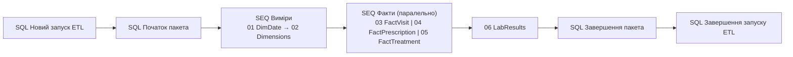
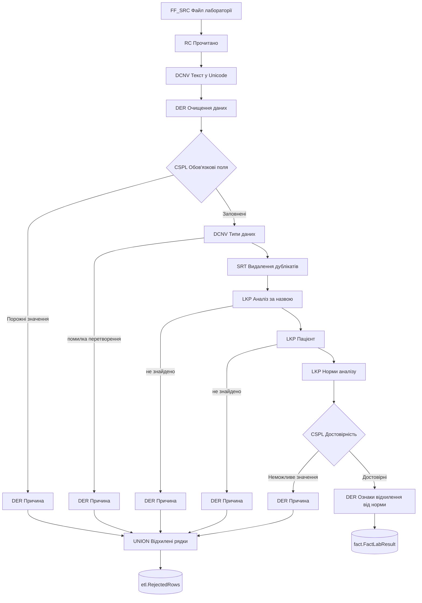
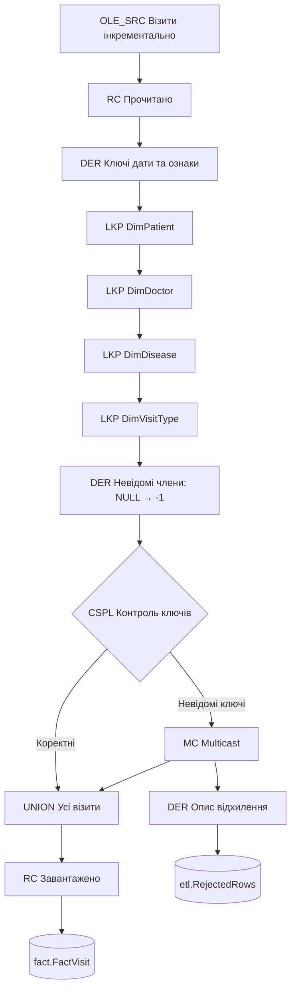

# Етап 3. ETL-процеси (SQL Server Integration Services)

## 3.1 Середовище та проєкт SSIS

| Компонент | Версія / значення |
|---|---|
| Середовище розробки | Visual Studio 2026 + SQL Server Integration Services Projects |
| Цільова версія | SQL Server 2022 (`TargetServerVersion = SQLServer2022`), модель розгортання — Project |
| Виконання | Visual Studio (F5) або `DTExec` (Integration Services 2022) |
| Джерела | `PolyclinicDB` (OLTP, OLE DB / MSOLEDBSQL), CSV-файли лабораторії (Flat File, UTF-8) |
| Призначення | `PolyclinicDW` (сховище даних) |

**Структура `SSIS_Projects/`:**

```
SSIS_Projects/
├── PolyclinicETL.sln              — рішення Visual Studio
├── PolyclinicETL/                 — проєкт SSIS: 7 пакетів .dtsx, PolyclinicETL.dtproj
├── DataWarehouse/                 — SQL-скрипти сховища (таблиці, процедури ETL, тест змін)
├── LabFiles/                      — Inbox (нові файли) → Archive (оброблені) / Rejected (відхилені)
├── Builder/                       — генератор пакетів (C#, об'єктна модель SSIS)
└── run_etl.ps1                    — повний запуск ETL з командного рядка
```

**Підключення (Connection Managers)** — у кожному пакеті однакові:
- `OLTP_PolyclinicDB` — джерело, `DW_PolyclinicDW` — сховище. Рядок підключення формується виразом
  із змінної `User::ServerName`, тому сервер змінюється в одному місці.
- `FF_LabFile` — CSV-файл лабораторії. Шлях задає цикл For Each через змінну `User::CurrentFile`.

> Пакети створено програмно скриптом `Builder/build.ps1` через офіційну об'єктну модель SSIS
> (ті ж класи, що використовує дизайнер Visual Studio). Тому всі пакети повторювано
> перебудовуються однією командою. Це звичайні `.dtsx`: проєкт відкривається, редагується
> і збирається у Visual Studio (`PolyclinicETL.ispac`, перевірка узгодженості проєкту успішна).

## 3.2 Сховище даних PolyclinicDW

### Схема «сузір'я фактів»
Чотири таблиці фактів мають спільні виміри (conformed dimensions); кожен факт разом зі своїми
вимірами утворює «зірку».

```mermaid
erDiagram
    DimDate ||--o{ FactVisit : DateKey
    DimPatient ||--o{ FactVisit : PatientKey
    DimDoctor ||--o{ FactVisit : DoctorKey
    DimDisease ||--o{ FactVisit : DiseaseKey
    DimVisitType ||--o{ FactVisit : VisitTypeKey
    DimAgeGroup ||--o{ FactVisit : AgeGroupKey

    DimDate ||--o{ FactPrescription : DateKey
    DimPatient ||--o{ FactPrescription : PatientKey
    DimDoctor ||--o{ FactPrescription : DoctorKey
    DimDisease ||--o{ FactPrescription : DiseaseKey
    DimMedication ||--o{ FactPrescription : MedicationKey
    DimAgeGroup ||--o{ FactPrescription : AgeGroupKey

    DimDate ||--o{ FactTreatment : "OpenDateKey, CloseDateKey"
    DimPatient ||--o{ FactTreatment : PatientKey
    DimDoctor ||--o{ FactTreatment : DoctorKey
    DimDisease ||--o{ FactTreatment : DiseaseKey
    DimOutcome ||--o{ FactTreatment : OutcomeKey
    DimAgeGroup ||--o{ FactTreatment : AgeGroupKey

    DimDate ||--o{ FactLabResult : DateKey
    DimPatient ||--o{ FactLabResult : PatientKey
    DimLabTest ||--o{ FactLabResult : LabTestKey
    DimAgeGroup ||--o{ FactLabResult : AgeGroupKey
```



### Таблиці фактів (4)

| Факт | Зерно | Міри | Записів |
|---|---|---|---:|
| `fact.FactVisit` | один візит | Cost, DurationMin, IsCompleted, IsNoShow, PrescriptionCount, MedicationCost | 1 086 026 |
| `fact.FactPrescription` | одне призначення ліків | Quantity, UnitPrice, TotalCost, DurationDays | 1 011 647 |
| `fact.FactTreatment` | закрита історія хвороби | TreatmentDays, NormTreatmentDays, DaysOverNorm, VisitCount, TotalVisitCost, IsRecovered, IsPositive, IsWithinNorm, ComorbidityCount | 534 961 |
| `fact.FactLabResult` | результат одного аналізу | ResultValue, IsAbnormal, IsHigh, IsLow | 101 558 |

### Виміри (9)

| Вимір | Тип | Ієрархії / ключові атрибути |
|---|---|---|
| `DimDate` | генерується | Рік → Квартал → Місяць → День; день тижня, тиждень ISO, сезон, свята, робочий день |
| `DimPatient` | **SCD Type 2** (місто, регіон, наявність страховки), SCD1 (ПІБ, стать, дата народження, група крові) | Регіон → Місто; стать, рік народження |
| `DimDoctor` | **SCD Type 2** (спеціальність, відділення, категорія), SCD1 (ПІБ, дати, статус) | Відділення → Спеціальність → Лікар |
| `DimDisease` | SCD Type 1 | Клас МКХ-10 → Хвороба; тип перебігу, тяжкість |
| `DimMedication` | SCD Type 1 | Фармгрупа → Препарат; цінова категорія, рецептурність |
| `DimAgeGroup` | статичний | Категорія (діти/дорослі/літні) → Вікова група |
| `DimVisitType` | статичний junk-вимір | Тип візиту × статус |
| `DimOutcome` | статичний | Група результату → Результат |
| `DimLabTest` | статичний | Група аналізів → Аналіз; референтні межі |

- Кожен вимір має **невідомий член** з ключем `-1`. Якщо при завантаженні факту ключ виміру не
  знайдено, рядок не втрачається: він отримує ключ -1 і записується в журнал відхилень.
- **SCD Type 2** реалізовано через staging (`stg.Patient`, `stg.Doctor`) і процедури
  `etl.usp_Merge_DimPatient` / `etl.usp_Merge_DimDoctor`. Вони закривають поточну версію
  (`ValidTo`, `IsCurrent = 0`) і додають нову. Перша версія діє з 1900-01-01 і покриває всю
  історію фактів.

## 3.3 Пакети ETL



| Пакет | Призначення |
|---|---|
| `00_Master` | Повний запуск: Execute Package Task для всіх пакетів; виміри послідовно, факти паралельно |
| `01_Load_DimDate` | Генерація календаря 2015–2026 (процедура `etl.usp_Load_DimDate`) |
| `02_Load_Dimensions` | Хвороби та ліки (SCD1, виявлення змін у SSIS); пацієнти та лікарі (SCD2, інкрементально) |
| `03_Load_FactVisit` | Візити (інкрементально за VisitID), контроль невідомих ключів |
| `04_Load_FactPrescription` | Призначення ліків (інкрементально за PrescriptionID) |
| `05_Load_FactTreatment` | Закриті історії хвороб: агрегування візитів, показники ефективності лікування |
| `06_Load_LabResults` | CSV-файли лабораторії: перевірка, очищення, відсів, завантаження, архівування |

### 3.3.1 Extract (вилучення)
- **OLE DB Source** з SQL-запитом. Для інкрементальних пакетів запит береться зі змінної
  (`SQL command from variable`). Вираз змінної підставляє межу останнього завантаження:
  - `WHERE v.VisitID > @[User::LastVisitID]` — візити;
  - `WHERE p.ModifiedAt > '@[User::PatientWatermark]'` — пацієнти.
- Межі (watermark) зберігаються в `etl.Watermark`: їх читає Execute SQL Task перед потоком даних
  і оновлює після нього.
- **Flat File Source** для CSV (UTF-8, роздільник `;`, заголовок у першому рядку).

### 3.3.2 Transform (перетворення) — 7 типів

| № | Перетворення | Де використано | Що робить |
|---|---|---|---|
| 1 | **Data Cleansing** | 06 `DER Очищення даних`, `SRT Видалення дублікатів`, `CSPL Обов'язкові поля`; 02 `DER Очищення та атрибути`, `DER Атрибути ліків` | TRIM пробілів; UPPER; видалення префікса `P-`; десяткова кома → крапка; три формати дат (`2025-03-15`, `15.03.2025`, `03/15/2025`) → ISO; NULL → «Невідомо»; видалення дублікатів; приклад правила: від'ємні та неможливі значення аналізу відхиляються |
| 2 | **Data Conversion** | 02 `DCNV Коди МКХ у Unicode`; 06 `DCNV Текст у Unicode`, `DCNV Типи даних` | varchar → nvarchar; UTF-8 DT_STR → DT_WSTR; текст → INT / NUMERIC(10,3) / DATE. Помилки перетворення направляються в окремий вихід |
| 3 | **Derived Column** | усі пакети | Ключ дати `yyyymmdd`, вікова група, ПІБ та ініціали, тривалість лікування й відхилення від нормативу, ознаки одужання, вище/нижче норми, категорія ціни |
| 4 | **Lookup** | 03–05 `LKP DimPatient/DimDoctor/…`; 02 `LKP Наявна хвороба`; 05 `LKP Вже завантажені`; 06 `LKP Аналіз за назвою`, `LKP Пацієнт`, `LKP Норми аналізу` | Сурогатні ключі вимірів (повний кеш); виявлення нових і змінених рядків; захист від повторного завантаження; словник варіантів назв аналізів (GLU / Glucose / глюкоза → GLU) |
| 5 | **Aggregate** | 05 `AGG Візити по історії хвороби` | Групування 1,08 млн візитів за історією хвороби: кількість візитів, кількість тих, що відбулися, сумарна вартість |
| 6 | **Conditional Split** | 02 `CSPL Чи змінилась`; 03 `CSPL Контроль ключів`; 06 `CSPL Обов'язкові поля`, `CSPL Достовірність` | Змінені / без змін; коректні рядки / рядки з невідомими ключами; заповнені / порожні; достовірні / неможливі значення |
| 7 | **Union All** | 03 `UNION Усі візити`; 06 `UNION Відхилені рядки` | Об'єднання коректних рядків з рядками з ключем -1; об'єднання 5 потоків відхилених рядків в один журнал |

Додатково використано: **Multicast** (рядок із невідомим ключем одночасно завантажується і
журналюється), **Sort** (видалення дублікатів), **Row Count** (лічильники для аудиту).

**Потік даних пакета 06 (очищення файлів лабораторії):**



**Потік даних пакета 03 (візити):**



### 3.3.3 Load (завантаження)
- **OLE DB Destination** у режимі *fast load*: `TABLOCK, CHECK_CONSTRAINTS` (обмеження FOREIGN KEY
  перевіряються), фіксація кожні 100 000 рядків.
- **Інкрементальне завантаження:**
  - факти — за зростаючим ідентифікатором (VisitID, PrescriptionID);
  - історії хвороб — за `ModifiedAt` у межах (watermark; нова межа], бо історія може закритися пізніше;
  - виміри SCD2 — за `ModifiedAt`.
- **Оновлення SCD Type 1:** змінені рядки, виявлені Lookup + Conditional Split, пишуться в
  `stg.*Update`, після чого Execute SQL Task виконує один пакетний UPDATE.
- **Ідемпотентність:**
  - повторний запуск без змін у джерелі нічого не додає;
  - повторна обробка файлу лабораторії спочатку видаляє попередні рядки цього файлу;
  - `LKP Вже завантажені` відсікає історії хвороб, які вже є у факті.

## 3.4 Контейнери та задачі

| Елемент | Використання |
|---|---|
| **Execute SQL Task** | Початок/завершення пакета (`etl.usp_PackageStart/End`), читання та оновлення watermark, SCD2 Merge, оновлення SCD1, очищення staging, видалення попередніх даних файлу, журнал файлу |
| **Script Task** (C#) | `SCR Перевірка файлу` у пакеті 06: розмір файлу, заголовок (структура колонок), кількість рядків → змінні `FileIsValid`, `FileMessage`, `FileLineCount`, `FileSizeKB` |
| **For Each Loop Container** | `FELC Файли лабораторії`: Foreach File Enumerator по `*.csv` у папці `Inbox` |
| **Sequence Container** | 02: `SEQ Довідникові виміри (SCD Type 1)`, `SEQ Пацієнти та лікарі (SCD Type 2)`; 00: `SEQ Виміри`, `SEQ Факти (паралельно)` |
| **Execute Package Task** | Головний пакет запускає пакети 01–06 |
| **File System Task** | Перенесення файлу в `Archive` (оброблено) або `Rejected` (неправильна структура) |
| **Precedence Constraints з виразами** | `@[User::FileIsValid] == TRUE` → завантаження, `== FALSE` → відхилення файлу |
| **Event Handlers** | `OnError` у кожному пакеті → `etl.usp_LogError`: пакет, задача, код і текст помилки; статус пакета → Failed |

Код Script Task (метод `Main`):

```csharp
string path = Dts.Variables["User::CurrentFile"].Value.ToString();
string expected = Dts.Variables["User::ExpectedHeader"].Value.ToString();
// ... читання заголовка та підрахунок рядків ...
if (fi.Length == 0 || header == null) message = "Порожній файл";
else if (header.Trim().TrimStart('') != expected) message = "Неочікувана структура файлу. Заголовок: " + header;
else if (lines == 0) message = "Файл не містить рядків даних";
else { valid = true; message = "OK"; }
Dts.Variables["User::FileIsValid"].Value = valid;
```

## 3.5 Контроль якості ETL

| Таблиця | Вміст |
|---|---|
| `etl.ETLRun` | Запуски ETL: початок, завершення, статус |
| `etl.PackageLog` | Кожен пакет: тривалість, статус, рядків прочитано / вставлено / оновлено / відхилено |
| `etl.ErrorLog` | Помилки з обробника OnError |
| `etl.RejectedRows` | Відхилені рядки даних з причиною та вихідними даними |
| `etl.FileLog` | Кожен файл лабораторії: розмір, рядків, завантажено, відхилено, дублікатів, статус |
| `etl.Watermark` | Межі інкрементального завантаження |
| `etl.vw_PackageRuns`, `etl.vw_RejectedSummary` | Звіти для перегляду результатів |

### Перший повний запуск (порожнє сховище) — 44 с

| Пакет | Прочитано | Вставлено | Відхилено | с |
|---|---:|---:|---:|---:|
| 01_Load_DimDate | — | 4 383 | 0 | 0 |
| 02_Load_Dimensions | 55 262 | 55 262 | 0 | 1 |
| 03_Load_FactVisit | 1 086 025 | 1 086 025 | 0 | 22 |
| 04_Load_FactPrescription | 1 011 646 | 1 011 646 | 0 | 21 |
| 05_Load_FactTreatment | 1 081 455 візитів | 534 960 історій | 0 | 19 |
| 06_Load_LabResults | 106 787 | 101 558 | 5 229 | 19 |

**Звірка з джерелом:** кількість рядків усіх фактів збігається з OLTP. Сума вартості візитів у
сховищі та в OLTP однакова (425 824 122,00 грн), невідомих ключів — 0.

**Файли лабораторії:** 24 файли завантажено, 1 файл (`…_partner_export.csv`, інша структура)
відхилено Script Task і перенесено в `Rejected`. Із 106 787 рядків завантажено 101 558,
видалено 2 046 дублікатів і відхилено 3 183 некоректні рядки (разом 5 229):

| Причина | Рядків |
|---|---:|
| Дублікати (видалено Sort) | 2 046 |
| Порожнє обов'язкове значення | 1 654 |
| Некоректний формат числа, дати або ідентифікатора («н/д») | 535 |
| Пацієнта не знайдено | 390 |
| Неможливе значення результату | 313 |
| Невідомий аналіз | 291 |

### Тест інкрементального завантаження та SCD
Скрипт `DataWarehouse/03_TEST_INCREMENTAL_CHANGES.sql` вносить зміни в OLTP:
- 25 пацієнтів переїхали;
- 10 пацієнтів оформили страховку;
- 5 прізвищ виправлено;
- 2 лікарі отримали вищу категорію;
- змінились ціни 3 препаратів;
- додано новий візит із призначенням, одну історію хвороби закрито.

Повторний запуск `00_Master` (5 с):

| Пакет | Прочитано | Вставлено | Оновлено |
|---|---:|---:|---:|
| 02_Load_Dimensions | 206 | 0 | 45 |
| 03_Load_FactVisit | 1 | 1 | — |
| 04_Load_FactPrescription | 1 | 1 | — |
| 05_Load_FactTreatment | 3 візити | 1 історія | — |

Результат SCD Type 2 (історія пацієнта):

| PatientID | City | ValidFrom | ValidTo | IsCurrent |
|---|---|---|---|---|
| 1 | Львів | 1900-01-01 | 2026-10-29 | 0 |
| 1 | Біла Церква | 2026-10-30 | 9999-12-31 | 1 |

Лікар 41: категорія «Перша» (до 2026-10-29) → «Вища» (з 2026-10-30). Ціна парацетамолу в
`DimMedication` перезаписана (SCD1): 35,00 → 38,50.

## 3.6 Запуск
- **Visual Studio:** відкрити `SSIS_Projects/PolyclinicETL.sln` → `00_Master.dtsx` → Start (F5).
- **Командний рядок:** `powershell -File SSIS_Projects\run_etl.ps1 [-RestoreLabFiles]`.
  Параметр `-RestoreLabFiles` повертає оброблені файли лабораторії в `Inbox`.
- **Перебудова пакетів:** `powershell -File SSIS_Projects\Builder\build.ps1 [-Run]`.
  Змінні з абсолютними шляхами (`PackagesFolder`, `InboxFolder`) формуються за поточним
  розташуванням проєкту.
