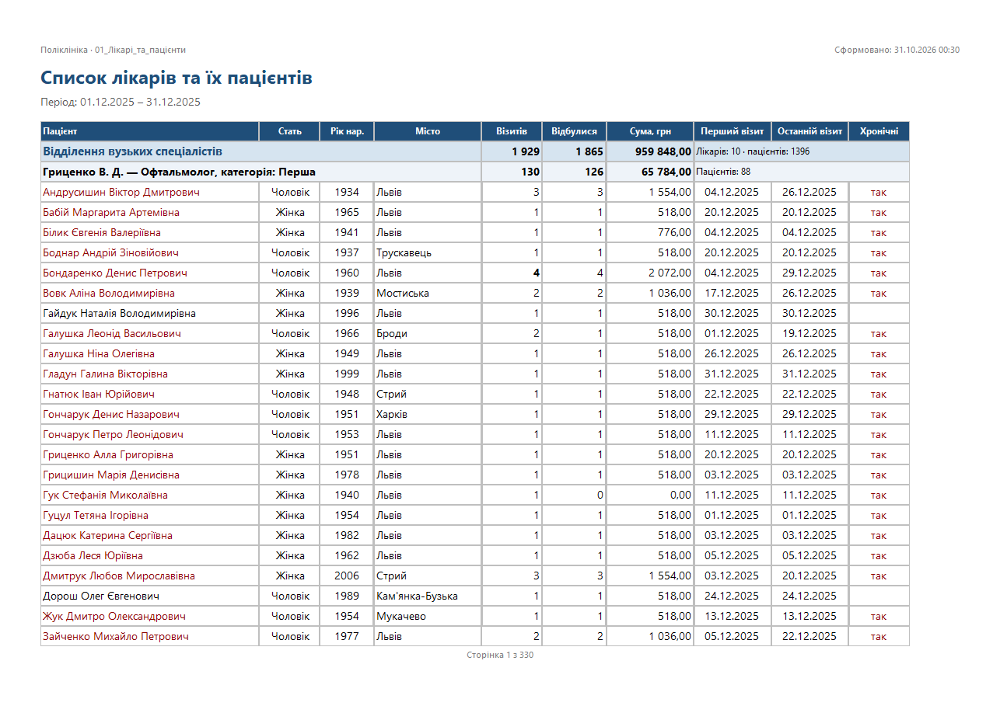
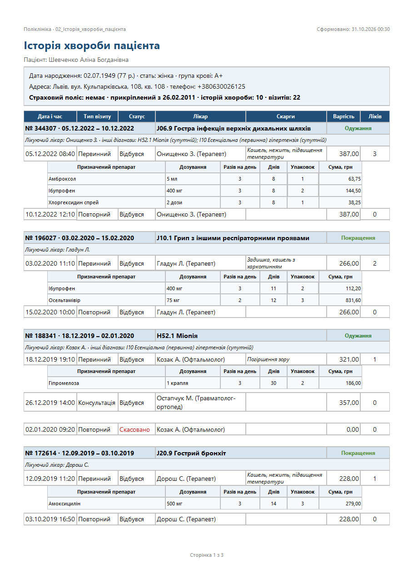
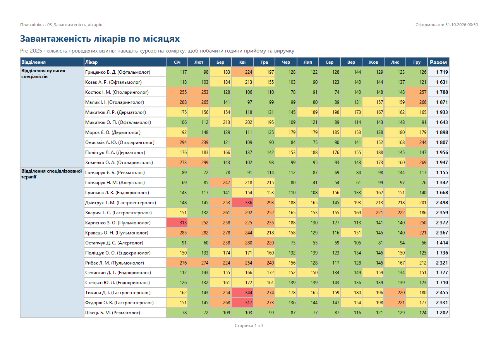
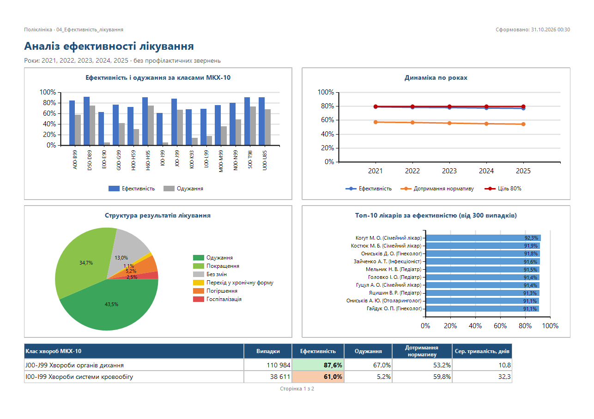
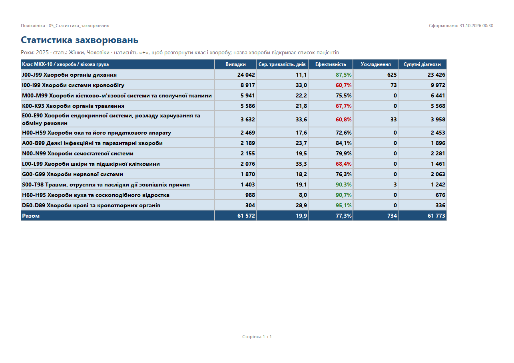
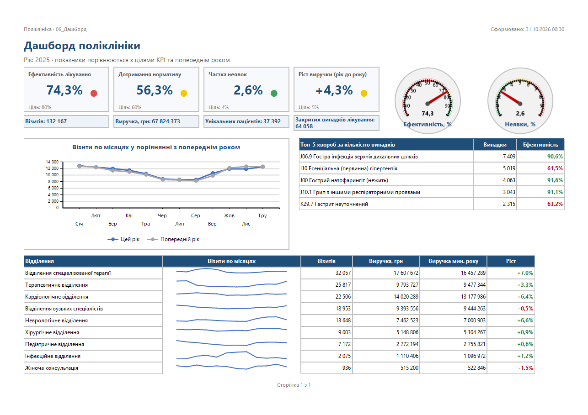
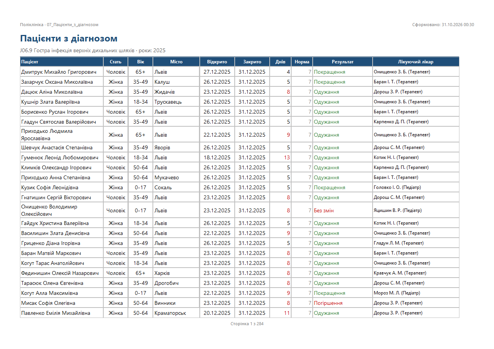

# Етап 5. Аналітичні звіти (SQL Server Reporting Services)

## 5.1 Проєкт SSRS

| Параметр | Значення |
|---|---|
| Сервер звітів | SQL Server 2022 Reporting Services (Developer), `http://localhost/ReportServer`, портал `http://localhost/Reports` |
| Проєкт Visual Studio | `SSRS_Projects/PolyclinicReports.sln` → `PolyclinicReports.rptproj` (Report Server Project) |
| Папка на сервері | `/Поліклініка` (звіти), `/Поліклініка/Джерела даних` (спільні джерела) |
| Формат звітів | RDL 2016 (SQL Server 2016+ Reporting Services) |

**Спільні джерела даних (Shared Data Sources):**

| Джерело | Тип | Підключення | Використання |
|---|---|---|---|
| `PolyclinicOLAP` | Microsoft SQL Server Analysis Services (MDX) | `localhost`, база `PolyclinicOLAP` | **OLAP-куб** — звіти 03, 04, 05, 06 |
| `PolyclinicDW` | Microsoft SQL Server | `PolyclinicDW` | Сховище даних — звіти 01, 07, списки параметрів |
| `PolyclinicDB` | Microsoft SQL Server | `PolyclinicDB` | OLTP (клінічні деталі: дозування ліків, скарги) — звіт 02 |

**Структура `SSRS_Projects/`:**

```
SSRS_Projects/
├── PolyclinicReports.sln
├── PolyclinicReports/          — 8 звітів .rdl, 3 спільні джерела .rds, .rptproj
├── Builder/
│   ├── rdl.py, reports.py      — генерація звітів (опис звітів → RDL)
│   ├── validate_rdl.ps1        — перевірка звітів за XML-схемою RDL
│   ├── deploy_reports.ps1      — розгортання на сервер звітів (SOAP API ReportService2010)
│   └── test_reports.ps1        — перевірка параметрів і експорту
└── Exports/                    — експортовані звіти (PDF, Excel, Word) і знімки сторінок
```

## 5.2 Звіти

| № | Звіт | Тип (вимога 5.2) | Джерело | Обов'язковий звіт варіанта |
|---|---|---|---|---|
| 01 | Список лікарів та їх пацієнтів | **Табличний** (Table) | DW | 1. Список лікарів та їх пацієнтів |
| 02 | Історія хвороби пацієнта (+ вкладений 02a) | Детальний з **вкладеним звітом** | OLTP | 2. Історія хвороби пацієнта |
| 03 | Завантаженість лікарів по місяцях | **Матричний** (Matrix) | OLAP | 3. Завантаженість лікарів по місяцях |
| 04 | Аналіз ефективності лікування | **З діаграмами** (Chart) | OLAP | 4. Аналіз ефективності лікування |
| 05 | Статистика захворювань | **Деталізований drill-down** + drillthrough | OLAP | 5. Статистика захворювань |
| 06 | Дашборд поліклініки | **Дашборд** (Dashboard) | OLAP | — |
| 07 | Пацієнти з діагнозом | Ціль переходу drillthrough | DW | — |

### 01. Список лікарів та їх пацієнтів (табличний)
- Групування: **Відділення → Лікар → пацієнти**.
- Підсумкові рядки: на кожному рівні (візити, візити, що відбулися, сума; кількість лікарів
  і пацієнтів через `CountDistinct`) та загальний підсумок.
- **Сортування** кліком на заголовках: пацієнт, рік народження, місто, візити, сума, дати.
- **Розгортання/згортання** списку пацієнтів кліком на лікаря (Toggle).
- **Навігаційна карта** (Document Map) по відділеннях і лікарях; **розрив сторінки** між відділеннями.
- **Умовне форматування**: пацієнти з хронічними хворобами — темно-червоним, 4+ візити — жирним.



### 02. Історія хвороби пацієнта (вкладений звіт)
- Картка пацієнта: вік, стать, група крові, адреса, телефон, поліс, кількість історій і візитів.
- Історії хвороб (новіші першими): номер, період, основний діагноз, результат (кольором),
  лікуючий лікар, супутні діагнози й ускладнення.
- Під кожним візитом — **вкладений звіт `02a_Призначення_візиту`** з параметром `VisitID`:
  препарат, дозування, кратність, тривалість, упаковки, сума. Для візитів без призначень
  вкладений звіт приховано.
- Візити, що не відбулися, виділено червоним; навігаційна карта по історіях хвороб.



### 03. Завантаженість лікарів по місяцях (матричний, OLAP)
- Перехресна таблиця: рядки — **Відділення → Лікар**, стовпці — **місяці року** (сортування за
  номером місяця) + «Разом»; підсумковий рядок.
- Значення — проведені візити (агрегація `Sum`); **теплова карта** (умовне форматування фону):
  ≥ 300 — червоний, 220–299 — помаранчевий, 150–219 — жовтий, 1–149 — зелений.
- Підказка (ToolTip) кожної комірки: години прийому та виручка.
- MDX: `STRTOSET(@Department, CONSTRAINED) * [Лікар].[Лікар] * [Дата].[Місяць року]` у підкубі року.



### 04. Аналіз ефективності лікування (діаграми, OLAP)
Чотири типи діаграм:

| Діаграма | Тип | Зміст |
|---|---|---|
| Ефективність і одужання за класами МКХ-10 | **Column** | дві серії, вісь 0–100% |
| Динаміка по роках | **Line** | ефективність, дотримання нормативу, лінія цілі KPI 80% |
| Структура результатів лікування | **Pie** | частка кожного результату (`#PERCENT`) |
| Топ-10 лікарів за ефективністю (від 300 випадків) | **Bar** | `TOPCOUNT(FILTER(...))` |

Нижче — таблиця за класами з умовним форматуванням (ефективність < 75% — червоний фон,
≥ 85% — зелений).



### 05. Статистика захворювань (drill-down + drillthrough, OLAP)
- Три рівні деталізації: **клас МКХ-10 → хвороба → вікова група**. Рівні розгортаються кліком «+»
  (Toggle), за замовчуванням згорнуті.
- Показники: випадки, середня тривалість лікування (`Sum(Дні) / Sum(Випадки)` — коректне
  середнє на кожному рівні), ефективність (кольором), ускладнення, супутні діагнози.
- **Drillthrough**: клік на назві хвороби відкриває звіт **07** з параметрами `DiseaseKey`
  (ключ члена виміру, отриманий у MDX через `MEMBER_KEY`) і вибраними роками.
- Навігаційна карта по класах і хворобах.



### 06. Дашборд (OLAP)
- **Візуалізація KPI**: 4 плитки (ефективність лікування, дотримання нормативу, частка неявок,
  ріст виручки) зі значенням, ціллю та кольоровим маркером статусу KPI з куба
  (`KPIStatus`: зелений / жовтий / червоний).
- **Датчики (Gauges)**: радіальні датчики «Ефективність, %» і «Неявки, %» із зонами
  червоний / жовтий / зелений.
- Лінійна діаграма візитів по місяцях у порівнянні з попереднім роком (`Візити PY`).
- Таблиця відділень зі **спарклайнами** (міні-графік візитів по місяцях у кожному рядку), виручкою
  та ростом рік до року (кольором).
- Топ-5 хвороб за кількістю випадків.



### 07. Пацієнти з діагнозом (ціль drillthrough)
- Закриті випадки лікування з вибраним основним діагнозом за вибрані роки.
- Сортування за всіма основними стовпцями; тривалість понад норматив — червоним; результат
  кольором; підсумок: кількість випадків, ефективність, середня тривалість.



## 5.3 Параметризація

| Тип параметра | Де | Реалізація |
|---|---|---|
| **Dropdown** (випадаючий список з набору даних) | 02 — пацієнт; 03, 06 — рік; 07 — діагноз | `ValidValues` з набору даних (значення + підпис) |
| **Multi-select** з «Select All» | 01 — відділення, спеціальності, лікарі; 04 — роки, класи; 05 — роки, стать, класи | `MultiValue`; у SQL — `IN (@Doctor)`, у MDX — `STRTOSET(@Years, CONSTRAINED)`; за замовчуванням вибрано все |
| **Date Range** з валідацією | 01 — «Дата з» / «Дата по» | Якщо дата початку пізніша за дату кінця, таблиця прихована й показано повідомлення про помилку |
| **Cascading** (залежні списки) | 01 — **відділення → спеціальність → лікар**; 02 — **прізвище → пацієнт** | Набір значень наступного параметра фільтрується попереднім (`WHERE Department IN (@Department)`) |
| **Boolean** | 01 — «Лише пацієнти з хронічними хворобами»; 04 — «Враховувати профілактичні огляди» | У SQL — `HAVING @OnlyChronic = 0 OR ...`; у MDX — `FILTER(..., @IncludeZ = "True" OR ...)` |

Параметри OLAP-звітів мають значення у вигляді унікальних імен членів куба
(`[Дата].[Рік].&[2025]`, `[Лікар].[Відділення].&[Кардіологічне відділення]`), а підписи —
звичайні назви. Списки формуються SQL-запитами до сховища.

## 5.4 Додаткова функціональність

| Функція | Реалізація |
|---|---|
| **Conditional Formatting** | Кольори за умовами в 01, 02, 03 (теплова карта), 04, 05, 06, 07 |
| **Interactive Sorting** | Заголовки стовпців у 01, 04, 07 (`UserSort`) |
| **Toggle Items** | 01 (пацієнти лікаря), 02 (візити історії), 05 (клас → хвороба → вікова група) |
| **Document Map** | 01 (відділення, лікарі), 02 (історії хвороб), 03 (відділення), 05 (класи, хвороби) |
| **Export** | PDF, Excel (`EXCELOPENXML`), Word (`WORDOPENXML`) — стандартні засоби сервера; приклади в `SSRS_Projects/Exports` |
| **Subreports** | `02a_Призначення_візиту` у звіті 02 |
| **Page Breaks** | Між відділеннями у 01; формат A4 (альбомна/книжкова), повтор заголовків таблиць на кожній сторінці, нумерація «Сторінка N з M» |
| **Drillthrough** | 05 → 07 |

## 5.5 Розгортання

- `deploy_reports.ps1` створює папки `/Поліклініка` і `/Поліклініка/Джерела даних`, публікує 3 спільні
  джерела та 8 звітів і прив'язує посилання звітів на джерела. Альтернатива — у Visual Studio:
  Deploy (TargetServerURL `http://localhost/ReportServer`, TargetReportFolder `Поліклініка`).
- Після публікації звітам призначаються посилання на спільні джерела. Налаштування безпеки,
  облікових даних, кешування та розсилки виконано в порталі `http://asus/Reports`.

**Організація папок:**

| Папка | Вміст |
|---|---|
| `/Поліклініка` | 8 звітів |
| `/Поліклініка/Джерела даних` | 3 спільні джерела даних |

**Безпека та доступ** (Поліклініка → Manage → Security; рольова модель SSRS):

| Група | Роль | Права |
|---|---|---|
| `BUILTIN\Administrators` | Content Manager | Публікація, зміна, керування безпекою, підписками й кешем |
| `BUILTIN\Users` | Browser | Лише перегляд звітів і власні підписки |

**Збережені облікові дані джерел.** Кешування й розсилка виконуються без участі користувача, тому
кожне джерело в «Джерела даних» зберігає Windows-облікові дані (Credentials → «Using the following
credentials» → **Use as Windows credentials**). Пароль зберігається на сервері звітів у
зашифрованому вигляді.

**Кешування** (06 Дашборд → Manage → Caching): «Cache copies of this report and use them when
available», строк дії — **60 хв**. Перше відкриття дашборда виконує MDX-запити до куба, наступні
протягом години показують збережену копію без звернення до куба.

**Розсилка (Subscription)** (04 Ефективність лікування → Subscribe):

| Параметр | Значення |
|---|---|
| Опис | Щотижневий звіт ефективності лікування |
| Доставка | Windows File Share, `\\ASUS\C$\Users\user\Documents\NULP\Course 4\CourseProject_Reports` |
| Формат | PDF, нові версії з наростаючими номерами файлів |
| Розклад | щопонеділка о 08:00 — завдання SQL Server Agent (категорія «Report Server») |
| Перевірка | «Run now»: статус «The file "04_Ефективність_лікування.pdf" has been saved to … file share», PDF 363 КБ (копія — `SSRS_Projects/Exports/subscription_04_Ефективність_лікування.pdf`) |

Розклади SSRS виконуються службою **SQL Server Agent** (запуск — автоматичний).

## 5.6 Тестування

| Перевірка | Результат |
|---|---|
| Схема RDL (`validate_rdl.ps1`) | 8 звітів — 0 помилок |
| Публікація на сервер (серверна перевірка визначення звіту) | 8 звітів опубліковано без попереджень |
| Виконання з даними (рендеринг у PDF) | 7 звітів (+ вкладений у складі 02) — успішно, 0,5–10 с |
| Невірний діапазон дат | Показано повідомлення про помилку, таблицю приховано |
| Каскадні параметри | «Кардіологічне відділення» → у списках лише кардіологи; разом з «лише хронічні» — лише пацієнти з хронічними хворобами |
| Каскадний пошук пацієнта | Прізвище «Коваль» → список пацієнтів Коваль; звіт за першим із них |
| Булевий параметр + мультивибір | Звіт 04 з профілактичними оглядами за 2024–2025 рр. |
| Drillthrough | 07 з `DiseaseKey` (E11.9) і двома роками |
| Експорт | PDF, Excel, Word — файли в `SSRS_Projects/Exports` |
| Безпека | `BUILTIN\Users` — Browser, адміністратори — Content Manager |
| Кешування | Дашборд: кеш увімкнено, строк дії 60 хв |
| Розсилка | Запуск підписки — PDF збережено у спільну папку; розклад — щотижневе завдання SQL Server Agent |
